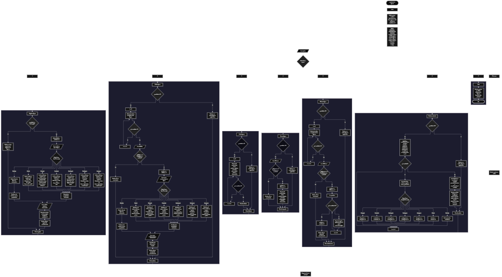

Este proyecto, llamado <b>anatomia de figuras</b>, fue desarrollado en <b>visual basic .net</b> como un ejercicio práctico para fortalecer la lógica de programación mediante la creación de un sistema de gestión y análisis de figuras geométricas desde la consola. El programa cuenta con un menú principal de siete opciones que permite <b>registrar, editar, eliminar, buscar, listar y consultar la anatomía</b> de las figuras registradas. Cada figura almacena información como su nombre, tipo, cantidad de lados, vértices, ángulos, perímetro, área, unidad de medida, estado y observaciones, utilizando arreglos con una capacidad máxima de <b>10 figuras durante la ejecución</b>. Además, permite realizar cálculos geométricos para triángulos, cuadrados, rectángulos, pentágonos, hexágonos y círculos, así como obtener estadísticas generales y promedios de las propiedades calculadas. Durante su desarrollo se aplicaron conceptos fundamentales de programación, como variables, arreglos, estructuras condicionales, ciclos repetitivos y estructuras de selección, además de operaciones aritméticas, acumuladores y procesos para buscar, modificar, eliminar y reorganizar registros.

<h2 align="center">⚙️ Funcionamiento del menú principal</h2>

### ➕ Registrar figura

La opción <b>1) registrar figura</b> permite almacenar una nueva figura geométrica en el sistema. Antes de realizar el registro, el programa comprueba que la cantidad de figuras almacenadas sea menor a la capacidad máxima de los arreglos, utilizando la condición <b>cantidad &gt;= ids.Length</b>. Si existe espacio disponible, asigna un identificador mediante la expresión <b>cantidad + 1</b> y solicita el <b>nombre y tipo de figura</b>. Después, utiliza una estructura <b>select case</b> para reconocer el tipo introducido y determinar sus propiedades geométricas. Para los triángulos establece tres lados, tres vértices y tres ángulos; solicita la base, altura y dos lados adicionales para calcular el perímetro y el área. Para los cuadrados solicita el lado y calcula el perímetro y el área. Para los rectángulos solicita la base y la altura, obteniendo sus respectivos cálculos. Para los pentágonos y hexágonos solicita el lado y la apotema para calcular el perímetro y el área. Finalmente, para los círculos establece cero lados, vértices y ángulos, solicita el radio y utiliza <b>Math.PI</b> para calcular la circunferencia y el área. Después solicita la unidad, el estado y la observación, almacena los datos en sus respectivos arreglos, incrementa la variable <b>cantidad</b> en uno y muestra el mensaje <b>"figura registrada correctamente."</b>. Si se alcanza la capacidad máxima, muestra el mensaje <b>"no hay espacio para registrar mas figuras."</b>. Si el tipo introducido no es reconocido, muestra <b>"tipo de figura no reconocido."</b>, aunque el programa continúa solicitando los demás datos y registra el elemento.

### ✏️ Editar figura

La opción <b>2) editar figura</b> permite modificar la información de una figura geométrica registrada. Primero, el programa comprueba si existen figuras almacenadas mediante la variable <b>cantidad</b>. Si no hay registros, muestra el mensaje <b>"no existen figuras registradas."</b>. En caso contrario, utiliza un ciclo <b>for</b> para presentar una lista con la información completa de cada figura, incluyendo su identificador, nombre, tipo, lados, vértices, ángulos, perímetro, área, unidad, estado y observación. Después, solicita el identificador de la figura que se desea editar y comprueba que esté dentro del rango permitido mediante la condición <b>idEditar &gt;= 1 And idEditar &lt;= cantidad</b>. Si la selección es válida, calcula la posición mediante <b>idEditar - 1</b> y solicita el nuevo nombre y tipo de figura. A continuación, utiliza una estructura <b>select case</b> para reconocer el nuevo tipo geométrico, establecer sus propiedades y solicitar las dimensiones necesarias para recalcular el perímetro y el área. Posteriormente, solicita la nueva unidad, estado y observación, actualiza los valores de los arreglos correspondientes y muestra el mensaje <b>"figura actualizada correctamente."</b>. Si el identificador introducido no corresponde a una posición dentro del rango permitido, presenta el mensaje <b>"ID no encontrada."</b>.

### 🗑️ Eliminar figura

La opción <b>5) eliminar figura</b> permite eliminar una figura geométrica mediante su identificador. Antes de comenzar, el programa comprueba que existan figuras registradas. Si no hay registros, muestra el mensaje <b>"no existen figuras registradas."</b>. En caso contrario, utiliza un ciclo <b>for</b> para mostrar la información completa de las figuras almacenadas. Después, solicita el identificador de la figura que se desea eliminar y verifica que esté dentro del rango permitido mediante la condición <b>idEliminar &gt;= 1 And idEliminar &lt;= cantidad</b>. Si la selección es válida, obtiene su posición mediante <b>idEliminar - 1</b> y utiliza otro ciclo <b>for</b> para desplazar una posición hacia atrás los datos de las figuras posteriores en los once arreglos: <b>ids, nombres, tipos, lados, vertices, angulos, perimetros, areas, unidades, estados y observaciones</b>. Posteriormente, disminuye la variable <b>cantidad</b> en uno y muestra el mensaje <b>"figura eliminada correctamente."</b>. De esta manera, los registros restantes quedan reorganizados dentro de las posiciones activas de los arreglos. Si el identificador no corresponde a una posición válida, muestra el mensaje <b>"ID no encontrada."</b>.

### 🔎 Buscar figura

La opción <b>4) buscar figura</b> permite localizar una figura geométrica mediante su identificador. Primero, el programa comprueba si existen figuras registradas. Si no hay registros, presenta el mensaje <b>"no existen figuras registradas."</b>. En caso contrario, solicita el identificador de la figura que se desea buscar y comprueba que se encuentre dentro del rango permitido mediante la condición <b>idBuscar &gt;= 1 And idBuscar &lt;= cantidad</b>. Si el identificador es válido, calcula la posición utilizando <b>idBuscar - 1</b> y muestra toda la información almacenada de la figura: <b>nombre, tipo, lados, vértices, ángulos, perímetro, área, unidad, estado y observación</b>. Si el identificador introducido no corresponde a una posición válida, muestra el mensaje <b>"ID no encontrada."</b>.

### 📋 Listar figuras

La opción <b>3) listar figuras</b> permite visualizar todas las figuras geométricas registradas actualmente en el sistema. Antes de mostrar la información, el programa comprueba si la variable <b>cantidad</b> es igual a cero. Si no existen registros, presenta el mensaje <b>"no existen figuras registradas."</b>. Si hay figuras disponibles, utiliza un ciclo <b>for</b> para recorrer los arreglos desde la primera posición hasta la última figura registrada. Durante el recorrido, muestra el identificador, nombre, tipo, cantidad de lados, vértices, ángulos, perímetro, área, unidad, estado y observación de cada figura. Esta función facilita consultar todos los registros existentes sin necesidad de buscar cada figura individualmente.

### 📄 Mostrar anatomía

La opción <b>6) mostrar anatomía</b> permite realizar un análisis general de las figuras geométricas registradas. Primero, el programa comprueba si existen registros almacenados. Si no hay figuras, muestra el mensaje <b>"no existen figuras registradas."</b>. En caso contrario, inicializa los contadores <b>triangulos, cuadrados, rectangulos, pentagonos, hexagonos y circulos</b> en cero. También inicializa los acumuladores <b>totalLados, totalVertices, totalAngulos, sumaAreas y sumaPerimetros</b>. Después, utiliza un ciclo <b>for</b> para recorrer todas las figuras registradas, acumular sus lados, vértices, ángulos, áreas y perímetros, y clasificar cada figura mediante una estructura <b>select case</b> que reconoce su tipo utilizando el método <b>ToLower()</b>. Al finalizar el recorrido, calcula el promedio del área mediante <b>sumaAreas / cantidad</b> y el promedio del perímetro mediante <b>sumaPerimetros / cantidad</b>. Finalmente, muestra la cantidad total de figuras, el número de figuras de cada tipo, la suma de lados, vértices y ángulos, además del promedio del área y del perímetro. Esta opción permite conocer las características generales de las figuras almacenadas.

### 🚪 Salir del menú principal

La opción <b>7) salir</b> está destinada a finalizar la ejecución del programa y muestra el mensaje <b>"gracias por utilizar anatomia de figuras."</b>. El menú principal se encuentra dentro de una estructura repetitiva <b>do ... loop while</b>, que mantiene el programa en funcionamiento mientras la opción seleccionada sea diferente de <b>7</b>. Cuando el usuario selecciona esta opción, el mensaje de despedida se muestra y la condición <b>opcion &lt;&gt; 7</b> permite finalizar el ciclo y terminar la ejecución del programa.

<h2 align="center">🧠 Temas aplicados en el proyecto</h2>

### 📦 Variables

En este proyecto se utilizan variables para controlar la opción seleccionada en el menú, administrar la cantidad de figuras registradas, recorrer los arreglos, identificar las posiciones de las figuras que se desean editar, buscar o eliminar, almacenar las dimensiones geométricas introducidas por el usuario y realizar los cálculos y análisis generales. También se emplean variables auxiliares dentro de las operaciones de registro y edición para almacenar temporalmente las dimensiones necesarias de cada figura.

🔢 **Opcion:** Almacena la opción seleccionada por el usuario en el menú principal.

📊 **Cantidad:** Controla el número actual de figuras registradas y permite determinar las posiciones ocupadas de los arreglos.

🔄 **I:** Funciona como contador en los ciclos `for`, permitiendo recorrer los arreglos y acceder a las figuras registradas.

📍 **Posicion:** Almacena el índice correspondiente a la figura seleccionada mediante su identificador para realizar las operaciones de edición, búsqueda y eliminación.

🆔 **IdEditar:** Almacena el identificador de la figura que se desea modificar.

🔎 **IdBuscar:** Almacena el identificador de la figura que se desea localizar.

🗑️ **IdEliminar:** Almacena el identificador de la figura que se desea eliminar.

📐 **BaseTriangulo, AlturaTriangulo, Lado1 y Lado2:** Almacenan temporalmente las dimensiones utilizadas para calcular el perímetro y el área de un triángulo.

📏 **LadoCuadrado:** Almacena la longitud del lado de un cuadrado para calcular sus propiedades geométricas.

📐 **BaseRectangulo y AlturaRectangulo:** Almacenan las dimensiones necesarias para calcular el perímetro y el área de un rectángulo.

📐 **LadoPentagono y ApotemaPentagono:** Almacenan las dimensiones utilizadas para calcular el perímetro y el área de un pentágono.

📐 **LadoHexagono y ApotemaHexagono:** Almacenan las dimensiones utilizadas para calcular el perímetro y el área de un hexágono.

⭕ **RadioCirculo:** Almacena el radio utilizado para calcular la circunferencia y el área de un círculo.

📊 **Triangulos, Cuadrados, Rectangulos, Pentagonos, Hexagonos y Circulos:** Funcionan como contadores para determinar la cantidad de figuras de cada tipo.

🔢 **TotalLados, TotalVertices y TotalAngulos:** Acumulan la cantidad de lados, vértices y ángulos de todas las figuras registradas.

📈 **SumaAreas y SumaPerimetros:** Acumulan las áreas y los perímetros para calcular sus respectivos promedios.

📊 **PromedioArea y PromedioPerimetro:** Almacenan los promedios de las áreas y los perímetros de las figuras registradas.

### 🗃️ Arreglos

En este proyecto se utilizan once arreglos paralelos relacionados con la información de cada figura geométrica. Cada arreglo tiene una capacidad de <b>10 posiciones</b> y utiliza el mismo índice para representar los datos correspondientes a una misma figura. Por ejemplo, la información de una figura almacenada en la posición <b>0</b> se encuentra distribuida entre <b>nombres[0], tipos[0], lados[0], vertices[0], angulos[0], perimetros[0], areas[0], unidades[0], estados[0] y observaciones[0]</b>, además de su identificador en <b>ids[0]</b>. Esta organización permite almacenar, recorrer, consultar, modificar, eliminar y analizar las figuras de manera ordenada.

🆔 **Ids[10]:** Almacena los identificadores asignados a las figuras registradas.

📝 **Nombres[10]:** Almacena los nombres de las figuras geométricas.

📐 **Tipos[10]:** Almacena los tipos de figuras, como triángulo, cuadrado, rectángulo, pentágono, hexágono y círculo.

🔢 **Lados[10]:** Almacena la cantidad de lados correspondiente a cada figura.

📍 **Vertices[10]:** Almacena la cantidad de vértices de cada figura.

📐 **Angulos[10]:** Almacena la cantidad de ángulos de cada figura.

📏 **Perimetros[10]:** Almacena los perímetros calculados de las figuras geométricas.

📊 **Areas[10]:** Almacena las áreas calculadas de las figuras geométricas.

📐 **Unidades[10]:** Almacena la unidad de medida introducida para cada figura.

📋 **Estados[10]:** Almacena el estado asignado a cada figura.

📝 **Observaciones[10]:** Almacena las observaciones adicionales de cada figura.

### 🔀 Estructuras condicionales

En este proyecto se utilizan las estructuras <b>if...else</b> para comprobar si los arreglos han alcanzado su capacidad máxima, verificar si existen figuras registradas antes de realizar determinadas operaciones y validar que los identificadores introducidos se encuentren dentro del rango permitido. También se utilizan para controlar la ejecución de las operaciones según las condiciones de cada figura. Estas estructuras permiten que el programa responda de manera diferente según la cantidad de registros almacenados y las selecciones realizadas por el usuario.

### 🔄 Estructuras repetitivas

En este proyecto se utilizan las estructuras repetitivas <b>do...loop while</b> y <b>for</b>. El ciclo <b>do...loop while</b> mantiene activo el menú principal y permite ejecutar diferentes operaciones hasta que el usuario selecciona la opción 7. Por otro lado, los ciclos <b>for</b> permiten recorrer los arreglos para mostrar las figuras registradas, presentar los datos antes de editarlos o eliminarlos, y acumular la información necesaria para realizar el análisis general. También se utilizan durante la eliminación para desplazar los datos de las figuras posteriores una posición hacia atrás.

### 🎯 Estructura select case

En este proyecto se utiliza la estructura <b>select case</b> para controlar las opciones del menú principal y determinar qué operación debe ejecutar el programa. Cada caso representa una funcionalidad específica: <b>registrar, editar, listar, buscar, eliminar, mostrar anatomía o salir</b>. También se utiliza otra estructura <b>select case</b> durante el registro y la edición para reconocer los seis tipos de figuras geométricas y ejecutar los cálculos correspondientes a cada una. Finalmente, se aplica durante el análisis general para clasificar las figuras y contabilizar cuántas existen de cada tipo.

### 🔢 Dimensionamiento de arreglos

El programa utiliza la declaración de arreglos con diez posiciones mediante expresiones como <b>ids(9), nombres(9), tipos(9)</b> y los demás arreglos. En Visual Basic .NET, esta declaración establece índices desde <b>0 hasta 9</b>, lo que proporciona una capacidad total de <b>10 figuras</b> por arreglo. La cantidad de posiciones ocupadas se controla mediante la variable <b>cantidad</b>, mientras que la propiedad <b>Length</b> permite comprobar la capacidad disponible antes de registrar una nueva figura.

### 🔄 Reorganización de registros

Cuando se elimina una figura, el programa utiliza un ciclo <b>for</b> que comienza en la posición seleccionada y continúa hasta <b>cantidad - 2</b>. Durante cada repetición, copia los datos de la posición siguiente sobre la posición actual en los once arreglos: <b>ids, nombres, tipos, lados, vertices, angulos, perimetros, areas, unidades, estados y observaciones</b>. Después, disminuye la variable <b>cantidad</b> en uno. De esta manera, los registros posteriores ocupan las posiciones anteriores y se mantiene organizada la información activa de las figuras. Sin embargo, los identificadores almacenados no se renumeran después de eliminar un registro.

### 📐 Operaciones geométricas

El proyecto aplica operaciones aritméticas para calcular las propiedades geométricas de seis figuras. Para los triángulos utiliza la suma de la base y los dos lados adicionales para obtener el perímetro, y multiplica la base por la altura y divide el resultado entre dos para calcular el área. Para los cuadrados multiplica el lado por cuatro para obtener el perímetro y el lado por sí mismo para calcular el área. Para los rectángulos suma dos veces la base y dos veces la altura para obtener el perímetro, y multiplica ambas dimensiones para calcular el área. En los pentágonos y hexágonos regulares multiplica el lado por cinco o seis, respectivamente, para obtener el perímetro, y utiliza la apotema para calcular el área. Para los círculos utiliza la constante <b>Math.PI</b> junto con el radio para calcular la circunferencia y el área.

### 📊 Contadores y acumuladores

Durante la opción <b>mostrar anatomía</b>, el programa utiliza contadores y acumuladores para obtener estadísticas de las figuras registradas. Los contadores permiten determinar cuántos triángulos, cuadrados, rectángulos, pentágonos, hexágonos y círculos existen. Los acumuladores <b>totalLados, totalVertices y totalAngulos</b> suman las propiedades correspondientes de todas las figuras. Asimismo, <b>sumaAreas</b> y <b>sumaPerimetros</b> reúnen los valores calculados para obtener el promedio del área y del perímetro mediante la división entre la cantidad total de figuras.

<h2 align="center">¿Cómo se implementaron las operaciones crud en el proyecto?</h2>

Las operaciones <b>crud</b> se implementaron mediante las opciones del menú principal, permitiendo administrar las figuras geométricas registradas. La operación <b>crear</b> corresponde a <b>registrar figura</b>, donde se introducen los datos de una nueva figura y se calculan sus propiedades geométricas; <b>leer</b> se realiza mediante las opciones <b>buscar figura y listar figuras</b>, que permiten consultar los registros almacenados; <b>actualizar</b> corresponde a <b>editar figura</b>, donde se modifican los datos y se recalculan las propiedades de una figura existente; y <b>eliminar</b> se realiza mediante la opción <b>eliminar figura</b>, que suprime el registro seleccionado y reorganiza los arreglos. Adicionalmente, la opción <b>mostrar anatomía</b> permite obtener estadísticas generales de las figuras almacenadas. Estas operaciones utilizan variables, arreglos, estructuras condicionales y ciclos para gestionar la información temporalmente durante la ejecución del programa.

<h2 align="center">Diagrama de flujo del proyecto</h2>

<h2 align="center">🛡️ Validaciones del programa</h2>

### 📭 No existen figuras registradas

Esta validación se utiliza en las opciones de <b>editar, eliminar, buscar, listar y mostrar anatomía</b>. El programa comprueba si la variable <b>cantidad</b> es igual a <b>0</b> y, si no existen figuras registradas, muestra el mensaje <b>"no existen figuras registradas."</b>. Esta comprobación evita continuar con las operaciones que necesitan información almacenada cuando los arreglos no contienen registros activos.

### ⚠️ Capacidad máxima alcanzada

Esta validación se utiliza durante el registro de nuevas figuras para controlar la capacidad máxima de los arreglos. El programa comprueba si <b>cantidad &gt;= ids.Length</b> antes de permitir almacenar una nueva figura. Si existe espacio disponible, continúa con el registro y aumenta la cantidad de figuras almacenadas. En caso contrario, muestra el mensaje <b>"no hay espacio para registrar mas figuras."</b>, impidiendo registrar más elementos mientras se mantenga ocupada la capacidad máxima de diez posiciones.

### ❌ Identificador no encontrado

Esta validación se utiliza durante las operaciones de <b>editar, buscar y eliminar</b>. El programa comprueba que el identificador introducido sea mayor o igual a <b>1</b> y menor o igual a <b>cantidad</b>. Si el valor se encuentra dentro del rango establecido, calcula la posición correspondiente mediante <b>identificador - 1</b> y continúa con la operación seleccionada. Si el identificador no cumple esta condición, muestra el mensaje <b>"ID no encontrada."</b>. Esta comprobación permite evitar el acceso a posiciones que se encuentran fuera del rango activo de los arreglos.

### 📐 Tipo de figura no reconocido

Durante el registro y la edición, el programa utiliza una estructura <b>select case</b> para reconocer los tipos de figuras geométricas disponibles: <b>triangulo, cuadrado, rectangulo, pentagono, hexagono y circulo</b>. Si el usuario introduce un tipo diferente, se ejecuta el bloque <b>case else</b> y se muestra el mensaje <b>"tipo de figura no reconocido."</b>. Sin embargo, esta condición no cancela el registro ni la edición, por lo que el programa continúa solicitando los demás datos. En el registro, las propiedades geométricas permanecen con sus valores iniciales; durante la edición, pueden conservar los valores anteriores de la figura.

### 🔢 Entrada numérica

El programa utiliza el método <b>Convert.ToInt32()</b> para convertir las opciones del menú y los identificadores introducidos por el usuario, mientras que <b>Convert.ToDouble()</b> permite convertir las dimensiones geométricas a valores numéricos decimales. Estas conversiones permiten realizar los cálculos matemáticos correspondientes. Sin embargo, el código no utiliza mecanismos como <b>TryParse()</b> para comprobar si los datos introducidos tienen un formato numérico válido, por lo que una entrada incorrecta puede provocar un error durante la ejecución.

### 🚪 Opción inválida

La estructura <b>select case</b> del menú principal incluye el bloque <b>case else</b>, que muestra el mensaje <b>"opcion no valida."</b> cuando el usuario introduce un número que no corresponde a ninguna de las opciones disponibles. Esta condición permite informar al usuario de que debe seleccionar una de las siete opciones definidas en el menú principal.

### ⚠️ Identificadores después de eliminar

Durante la eliminación de una figura, el programa desplaza los datos de los arreglos para reorganizar los registros activos y disminuye la variable <b>cantidad</b>. Sin embargo, los identificadores del arreglo <b>ids</b> no se renumeran. Como las operaciones de edición, búsqueda y eliminación calculan la posición mediante <b>identificador - 1</b>, después de eliminar una figura pueden producirse inconsistencias entre los identificadores almacenados y las posiciones reales de los registros. Además, un nuevo registro recibe el identificador <b>cantidad + 1</b>, por lo que podría repetirse un identificador existente.

### 📊 Cálculo de promedios

Durante el análisis general, el programa calcula el promedio del área y del perímetro dividiendo sus respectivos acumuladores entre la cantidad de figuras registradas. Antes de realizar estas operaciones, comprueba que <b>cantidad</b> sea diferente de cero, evitando dividir entre cero cuando no existen registros. Los resultados se almacenan en las variables <b>promedioArea</b> y <b>promedioPerimetro</b> para mostrarlos al usuario.

<h2 align="center">🎯 Objetivo del proyecto</h2>

El objetivo principal de este proyecto es fortalecer la <b>lógica de programación</b> mediante el desarrollo de un sistema de gestión y análisis de figuras geométricas en <b>visual basic .net</b>. A través de su construcción se busca aplicar los conocimientos adquiridos sobre variables, arreglos, estructuras condicionales, ciclos repetitivos y estructuras de selección, integrándolos con operaciones aritméticas y fórmulas geométricas para resolver problemas matemáticos de manera organizada. Además, el proyecto permite comprender cómo registrar, consultar, modificar, eliminar y analizar información mediante arreglos paralelos, estableciendo una base para desarrollar aplicaciones de gestión y cálculo más completas utilizando otros lenguajes y tecnologías.

